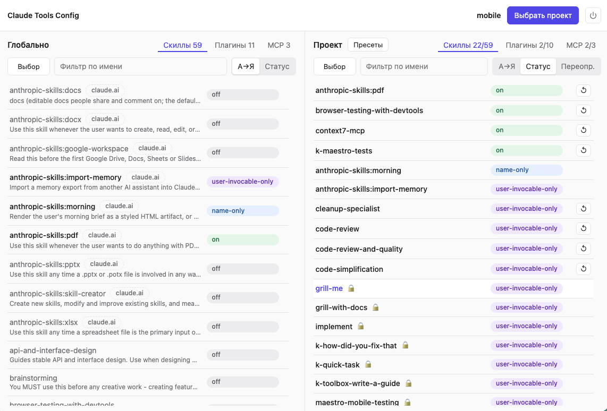

# Claude Tools Config

Приложение для управления скиллами, плагинами и MCP-серверами Claude Code — глобально и для каждого проекта отдельно. Запускается из консоли и имеет веб-интерфейс.

**Зачем.** Все инструменты, подключенные глобально, работают в каждом проекте. Описания скиллов занимают контекст в каждой сессии и конкурируют за внимание модели, даже если в текущей задаче не используются. А каждый MCP-сервер — это отдельный процесс, который держит память. Настройки разбросаны по `~/.claude/settings.json`, `~/.claude.json` и локальным настройкам проектов. Claude Tools Config позволяет настраивать все инструменты в одном месте.



## Возможности

- **Глобальные и проектные настройки.** Слева — всё установленное и его глобальное значение. Справа — итоговое значение в выбранном проекте: унаследованное или переопределенное (`↺` сбрасывает переопределение).
- **Скиллы:** `on`, `name-only`, `user-invocable-only`, `off`. Учитываются скиллы из claude.ai (`anthropic-skills:*`); заблокированные автором (`disable-model-invocation: true` в тексте скилла) отмечены 🔒, для них доступны только `user-invocable-only` и `off`.
- **Плагины и MCP:** `on` / `off`. У плагина видно, сколько в нём скиллов и MCP-серверов.
- **Режим выбора:** изменить значение сразу у нескольких элементов.
- **Пресеты:** сохранить набор переопределений и применить его к другому проекту.
- **Безопасность:** меняется только нужный ключ в файле. Перед изменением делается резервная копия (не чаще раза в час, 10 копий на файл). Копии хранятся в `~/.config/claude-tools-config/backups`

## Установка

Нужен **Python 3.11+**. Проверить установленный: `python3 --version` или `python --version`.

```bash
git clone <URL репозитория> claude-tools-config
```

### Короткая команда `ctc`

**macOS** (zsh) — добавьте в `~/.zshrc`, **Linux** (bash) — в `~/.bashrc`:

```bash
alias ctc='python3 /путь/к/claude-tools-config/app.py'
```

Затем `source ~/.zshrc` (или `~/.bashrc`).

**Windows** (PowerShell) — откройте профиль командой `notepad $PROFILE` и добавьте:

```powershell
function ctc { py "C:\путь\к\claude-tools-config\app.py" @args }
```

Затем перезапустите PowerShell.

## Запуск

```bash
cd /путь/к/проекту
ctc                # откроется браузер с проектом в текущей директории
ctc ~/other/app    # или укажите путь явно
```

- Без аргумента открывается текущая директория
- `--port 8765` — порт (по умолчанию 8765), `--no-browser` — не открывать браузер.
- Остановить: кнопка питания в правом верхнем углу или `Ctrl+C` в терминале.

Открытые сессии `claude` видят изменения только после перезапуска.

## Где что хранится

| Что | Где |
|---|---|
| Глобальные значения скиллов и плагинов | `~/.claude/settings.json` |
| Глобальные MCP и выключенные MCP проекта | `~/.claude.json` |
| Переопределения проекта | `<проект>/.claude/settings.local.json` |
| История, пресеты, выключенные глобально MCP, резервные копии | `~/.config/claude-tools-config/` |

`~` — домашняя директория: macOS `/Users/<имя>`, Linux `/home/<имя>`, Windows `C:\Users\<имя>` (`%USERPROFILE%`).


